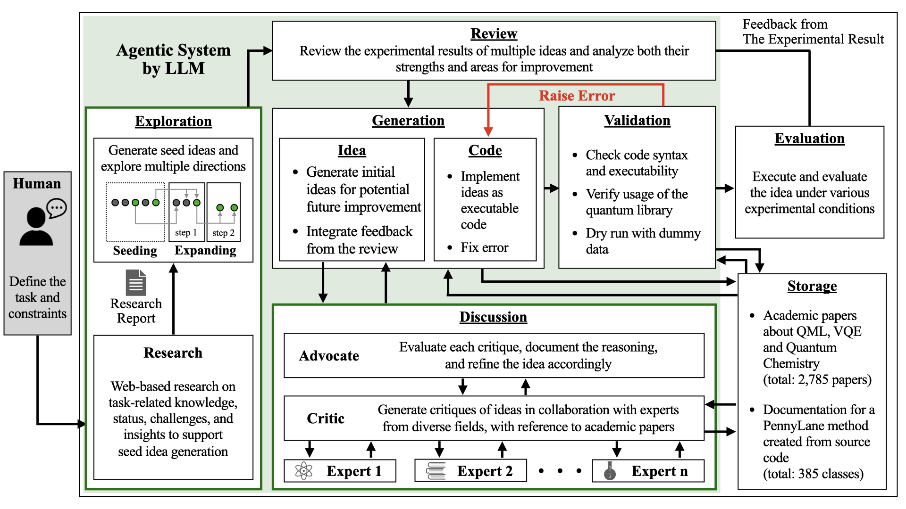

<div align="center">
    <!-- <a href=""> -->
    
    <!-- <h1 align="center">Astronaut</h1> -->
    <!-- </a> -->
</div>

<p align="center">
  This repository hosts the official implementation of the paper <a href="https://arxiv.org/abs/2504.07396" target="_blank"><em>"Automating quantum feature map design via large language models"</em></a>.
  <strong>Astronaut</strong> is an iterative LLM-driven agent that autonomously designs quantum circuits. It currently targets quantum feature maps for kernel methods such as support vector machines. The high-level system architecture is illustrated below.
</p>

<div align="center">
  
</div>

## Table of Contents
- [Installation](#installation)
- [Configuration](#configuration)
- [Usage](#usage)
- [Tutorials](#tutorials)
- [License](#license)


---

## Installation

### 1. Clone the repository

Clone the code base into your development environment.

```bash
git clone https://github.com/Qyusu/astronaut.git
cd astronaut
```

### 2. Set up Python 3.11

Astronaut is tested with Python 3.11. Other versions are currently unsupported. Tools such as `pyenv` make it easy to install and select the required interpreter.

```bash
pyenv install 3.11
pyenv local 3.11
python --version
>> Python 3.11.7
```

### 3. Install dependencies with uv

Install all Python dependencies through `uv`. If uv is not yet available on your system, refer to the [official installation guide](https://docs.astral.sh/uv/getting-started/installation/).

```bash
# install dependencies defined in uv.lock
uv sync

# activate the virtual environment
source .venv/bin/activate  # On Windows: .venv\Scripts\activate
```

### Alternative: Use Docker

If you prefer running Astronaut in a containerized environment, you can use the `Dockerfile` located in the repository root instead of steps 2 and 3.

```bash
# from the repository root
docker build -t astronaut .
docker run --rm -it --env-file .env -v "$(pwd)":/workspace astronaut /bin/bash
```

The container launches with the project mounted at `/workspace`, so you can follow the remaining configuration and usage steps from inside the shell.

---

## Configuration

1. Create a `.env` file by copying the template:

```bash
cp .env.sample .env
```

2. Provide the mandatory settings shown below (see `.env.minimum` for a minimal example).

| Type | Name | Description |
|------|------|-------------|
| API Key | OPENAI_API_KEY | API key for OpenAI services. |
| Model Setting | CHAT_PLATFORM | Target LLM platform: `"openai"`, `"google"`, or `"anthropic"`. |
| Model Setting | DEFAULT_LIGHT_MODEL_VERSION | Default model for lightweight tasks. |
| Model Setting | DEFAULT_MODEL_VERSION | Default model for general-purpose tasks. |

For model-version guidance and LangSmith options, consult the table below. Supported models can be found in the [OpenAI](https://platform.openai.com/docs/models), [Gemini](https://ai.google.dev/gemini-api/docs), and [Claude](https://docs.claude.com/en/docs/about-claude/models/overview) catalogs.

<details><summary>Optional Configuration</summary>

| Type | Name | Description |
|------|------|-------------|
| API Key | GOOGLE_API_KEY | Required only when using Google LLMs. |
| API Key | ANTHROPIC_API_KEY | Required only when using Anthropic LLMs. |
| API Key | PINECONE_API_KEY | Required when connecting to Pinecone for external knowledge. |
| API Key | LANGCHAIN_API_KEY | Required when enabling LangSmith tracing. |
| Model Setting | EXPANDING_MODEL_VERSION | Model for idea expansion. Defaults to `DEFAULT_MODEL_VERSION`. |
| Model Setting | IDEA_MODEL_VERSION | Model for idea generation. Defaults to `DEFAULT_MODEL_VERSION`. |
| Model Setting | SCORING_MODEL_VERSION | Model for idea scoring. Defaults to `DEFAULT_LIGHT_MODEL_VERSION`. |
| Model Setting | SUMMARY_MODEL_VERSION | Model for research-paper summarization. Defaults to `DEFAULT_LIGHT_MODEL_VERSION`. |
| Model Setting | EXPERT_MODEL_VERSION | Model for expert-style Q&A. Defaults to `DEFAULT_LIGHT_MODEL_VERSION`. |
| Model Setting | REFLECTION_MODEL_VERSION | Model for idea reflection tasks. Defaults to `DEFAULT_MODEL_VERSION`. |
| Model Setting | REFERENCE_EXTRACTION_MODEL_VERSION | Model for extracting code references. Defaults to `DEFAULT_LIGHT_MODEL_VERSION`. |
| Model Setting | CODE_MODEL_VERSION | Model for code generation. Defaults to `DEFAULT_MODEL_VERSION`. |
| Model Setting | VALIDATION_MODEL_VERSION | Model for code validation. Defaults to `DEFAULT_LIGHT_MODEL_VERSION`. |
| Model Setting | REVIEW_MODEL_VERSION | Model for idea reviews. Defaults to `DEFAULT_MODEL_VERSION`. |
| Embedding Setting | EMBEDDING_PLATFORM | Embedding provider (currently OpenAI only). Required when building or querying external knowledge. |
| Embedding Setting | EMBEDDING_MODEL_VERSION | Embedding model version, required with external knowledge. |
| Embedding Setting | EMBEDDING_DIM | Embedding dimensionality, required with external knowledge. |
| Database Setting | PENNYLANE_INDEX_NAME | Pinecone index name for PennyLane references. Required only when PennyLane knowledge is used. |
| Database Setting | ARXIV_INDEX_NAME | Pinecone index name for arXiv references. Required only when arXiv knowledge is used. |
| LangSmith Setting | LANGCHAIN_TRACING_V2 | Enable (`true`) or disable (`false`) LangSmith tracing. |
| LangSmith Setting | LANGCHAIN_ENDPOINT | LangSmith endpoint URL. |
| LangSmith Setting | LANGCHAIN_PROJECT | LangSmith project name. |
</details>

---

## Usage

### Optional: Database Setup
Astronaut can query external knowledge bases (e.g., documentation or research papers) during idea evaluation and code validation. Prepare these resources first, then launch experiments from the `astronaut/astronaut` directory.

For instructions on how to prepare the optional databases (PennyLane Documentation and arXiv Papers), please refer to [Database Setup](./docs/tutorials/database_setup.md).

### Run Experiments

After configuration, run the agent and monitor API usage. `max_trial_num` affects cost the most; with the reference settings the approximate cost is USD 2 per trial.

```bash
# run from astronaut/astronaut
# Quantum feature map for kernel methods
python3 main.py "../configs/quantum_kernel/experiment.yaml"

# Quantum ansatz for VQE
python3 main.py "../configs/vqe/experiment.yaml"
```

<details><summary>Key configuration fields</summary>

- `model_type` (string): `"quantum_kernel"` or `"vqe"`.
- `target_dataset_names` (list[string]): Datasets evaluated in the experiment.
- `experiment_name` (string): Human-readable experiment identifier.
- `desc` (string): Free-form experiment description.
- `max_trial_num` (integer): Maximum experiment iterations.
- `max_idea_num` (integer): Maximum ideas generated per trial.
- `max_suggestion_num` (integer): Maximum suggestions generated per idea.
- `expanding_steps` (list[integer]): Idea counts per expansion stage.
- `research_mode` (string): `"deep"`, `"light"`, or `"none"`.
- `existing_research_report_path` (string): Skip research by supplying an existing Markdown report.
- `reflection_type` (string): Reflection strategy: `"debate"`, `"self"`, or `"none"`.
- `max_reflection_round` (integer): Maximum refinements per suggestion.
- `max_scoring_round` (integer): Maximum scoring iterations per trial.
- `log_level` (string): File log level (TRACE, DEBUG, INFO, SUCCESS, WARNING, ERROR, CRITICAL).
- `console_log_level` (string): Console log level (TRACE, DEBUG, INFO, SUCCESS, WARNING, ERROR, CRITICAL).

</details>

---

## Tutorials

For detailed step-by-step guides on how to configure and run specific experiments, please refer to the following tutorials:

- **[Quantum Kernel Experiment Tutorial](./docs/tutorials/quantum_kernel.md)**: Design and optimize quantum feature maps for classification/regression.
- **[VQE Experiment Tutorial](./docs/tutorials/vqe.md)**: Design ansatzes for Variational Quantum Eigensolver tasks.

---

## Citing this work

If you use this code base in academic work, please cite:

```bibtex
@Article{Sakka2025,
  author  = {Kenya Sakka and Kosuke Mitarai and Keisuke Fujii},
  title   = {Automating quantum feature map design via large language models},
  journal = {arXiv preprint arXiv:2504.07396},
  year    = {2025},
  month   = {April},
  url     = {https://arxiv.org/abs/2504.07396},
  note    = {39 pages, 6 figures},
  doi     = {10.48550/arXiv.2504.07396}
}
```

## License

This project is distributed under the terms described in the [LICENSE](LICENSE) file.
